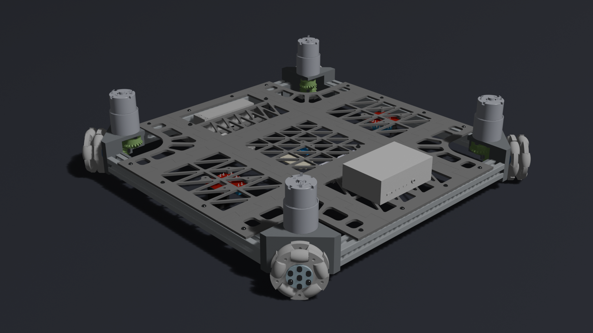
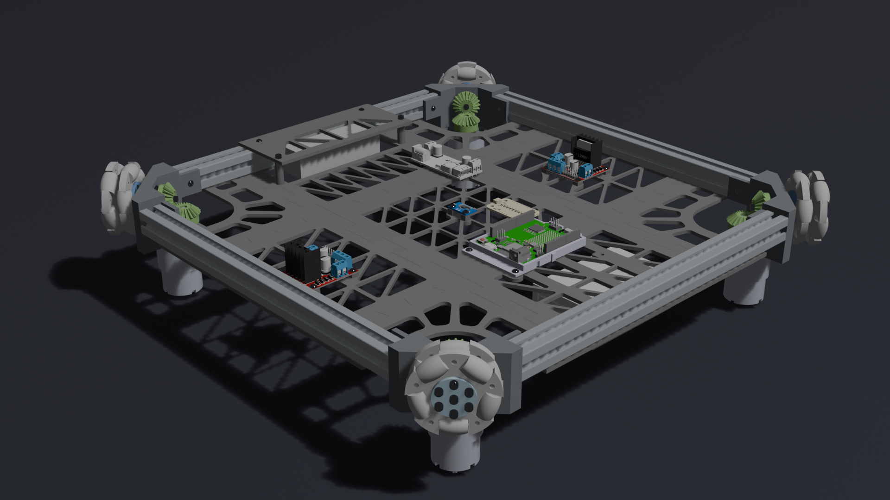
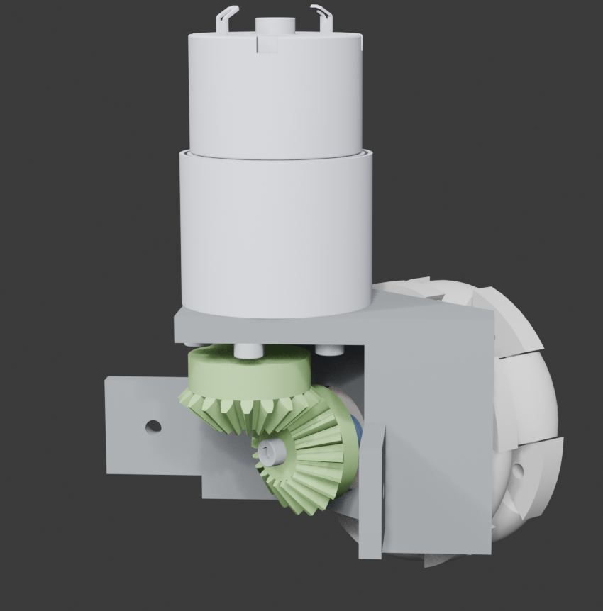
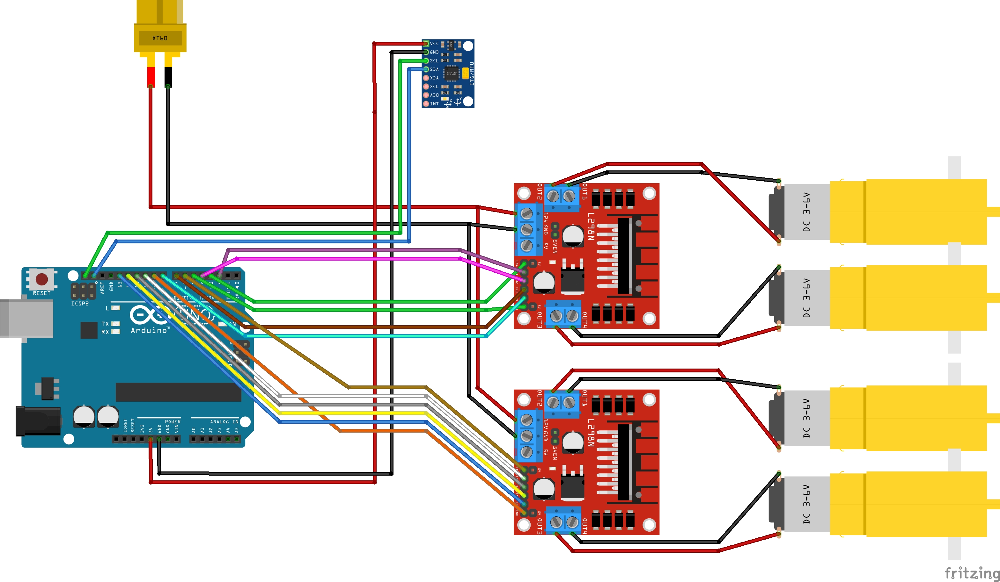

# OmniDirectionalDrivebase
omni directional drivebase powered by wireless communications via an SBC, and 4 motors with omni-wheels

[CAD can be found here](https://cad.onshape.com/documents/fe3bd4f660234e22787a5c68/w/c5ab235e4107ca0bd28327d7/e/e33989c89e838688db34004f?renderMode=0&uiState=6afa1c9f9f26db7e03904386) or in the hardware folder of this repo(.step format)
## Drive behind the project
I wanted to make my own drivebase for a while, along with a ton of other projects like a ball shooter. I ended up making this project as a base for any future ones, since its made out of aluminum extrusion and uses really easy serial commands for control, it is a great base for starting your own project. This project also leverages my own remote communications that use a Rock 4 C+ in conjunction with an Arduino Uno R4. This combination allows for fast communications, with the possibility to run computer vision and turn this project into a great hub for learning.
## Repo breakdown:
`assets` - Images used in this readme

`firmware` - Code to be uploaded to the Arduino via Platform IO

`hardware` - Fritzing wiring file and step file of CAD

`pythonscripts` - Python script for Rock 4, Station app for controls, and tutorial to set up Rock 4.

## Gallery
Robot renders

Robot Corner Module

Wiring Diagram:

>not all parts used in robot are available in fritzing so I used placeholders

## BOM:
| Item Name                                   | Qty        | Price (total) (USD) | Item link                                                         | Notes                                                                                      |
|---------------------------------------------|------------|---------------------|-------------------------------------------------------------------|--------------------------------------------------------------------------------------------|
| 2020 11.75 in Aluminum Extrusion            | 4          | Already Own         | https://www.tnutz.com/product/exm-2020/                           | Already Own                                                                                |
| M3 25 mm SHCS                               | 35 +       | $3.40               | https://www.aliexpress.us/item/2251832624557792.html              |                                                                                            |
| M3 10 mm BHCS                               | 37 +       | $2.05               | https://www.aliexpress.us/item/2251832624537980.html              |                                                                                            |
| M3 5 mm BHCS                                | 10 +       | $2.05               | https://www.aliexpress.us/item/2251832624537980.html              |                                                                                            |
| M3 Nut                                      | 4 +        | 1.17                | https://www.aliexpress.us/item/3256801780111387.html              |                                                                                            |
| M3 30 mm SHCS                               | 2 +        | $3.56               | https://www.aliexpress.us/item/2251832624557792.html              |                                                                                            |
| 0.375 in flanged bearing                    | 4          | Already Own         |                                                                   |                                                                                            |
| JGB 520 12 V 320 RPM                        | 4          | $41.64              | https://www.aliexpress.us/item/3256807249347989.html              |                                                                                            |
| L298N Motor Driver                          | 2          | $13.16              | https://www.aliexpress.us/item/3256811980939815.html              | Own 1, need second one                                                                     |
| MPU 6050                                    | 1          | $1.82               | https://www.aliexpress.us/item/3256807803434052.html              |                                                                                            |
| Rock 4 C+ Starter kit                       | 1          | Already Own         | https://store.arduino.cc/products/okdo-rock-4-model-c-starter-kit |                                                                                            |
| Arduino Uno R4 Wifi + included case         | 1          | Already Own         |                                                                   |                                                                                            |
| Arduino Modulino Pixels and Qwicc Connector | 1          | Already Own         |                                                                   |                                                                                            |
| HCW P715 12 V -> 5 V converter              | 1          | Already Own         |                                                                   |                                                                                            |
| USB to USB C                                | 2          | Already Own         |                                                                   |                                                                                            |
| 60 mm Omni Wheels                           | 4          | $60.20              | https://www.aliexpress.us/item/3256807443925760.html              |                                                                                            |
| 12 AWG Silicone wire                        | 1-2 meters | $9.44               | https://www.aliexpress.us/item/3256801611804443.html              | Double price since need red and black                                                      |
| Jumper wires(M - F)                         | 16 +       | Already Own         |                                                                   |                                                                                            |
| 3S 3200 mAh LIPO                            | 1          | $26.34              | https://www.aliexpress.us/item/3256809019522947.html              |                                                                                            |
| Lipo Charger                                | 1          | 49.76               | https://www.aliexpress.us/item/3256810269882275.html              |                                                                                            |
| XT60 Female Connector                       | 1           | $7.01               | https://www.aliexpress.us/item/3256812349188613.html              | Seller of battery doesn't have picture of real battery to know if female or male conenctor |
| M3 T Nuts                                   | 20 pcs     | $2.48               | https://www.aliexpress.us/item/2251832628044342.html              |                                                                                            |
| Total Price (USD):                          | $224.08    |Shipping:                     |     $31                                                              |                                                                                            |
> also can be found in bom.csv

## Building your own:
After acquiring the parts listed in the BOM, you are ready to start assembling.
**Tools:**
 - Allen key set
 - Zipties
 - Double sided tape
 - Flush cutters
 - Soldering iron(and the rest of the items needed to solder)
 - Wire cutters and strippers
 - Mini screwdriver set

**Suggested steps**
> as the project is still theoretical, and hasn't been built, these are "rough" steps which I recommend you follow when assembling
1. Software setup:
   - Clone repo: `git clone https://github.com/word9317/OmniDirectionalDrivebase` and enter it `cd OmniDirectionalDrivebase`
   - Install VSCode
   - In VSCode install Platform IO and libraries needed for the Arduino Uno R4
   - Setup python and Station app:
       - Run `pip install virtualenv` and create a virtual enviroment `virtualenv venv`, `./venv/Scripts/activate`
       - Install python packages: `pip install -r requirements.txt`
   - Follow [these instructions](./pythonscripts/SettingUpComms.md) to set up communications on the Rock 4 C+, use test.py to assess basic communications
   - Connect your Arduino Uno R4 to your PC, and open the firmware subdirectory, upload that code using Platform IO to the board.
   - Open `/pythonscripts/station` and run `python3 main.py` to see if driverstation shows up, if so, you are ready to get to the phyisical assembly
2. Assemble frame(follow CAD for screw sizes)
   - Use the aluminum extrusion and corner modules to make the frame
   - Assemble and install belly pan
   - Install arduino uno r4, rock 4 c+, motor drivers modulino pixels(use zipties), and buck converter(double sided tape)
3. Soldering time
   - Solder headers to MPU 6050
   - Place motor in motor slot of corner module, then approximate how much 12 AWG wire is needed and solder the wires onto the terminals on the motors
   - Install motors and MPU 6050 using screws according to CAD
4. Wire everything
   - Follow the wiring diagram(for jumper wires part like motor drivers, mpu, etc.)
   - Plug in XT60 connector into motor drivers, and also wire into the buck converter(use 12 AWG wire)
   - Connect buck converter USB to Rock 4 C+, and one of the Rock 4 C+(preferably USB 3.0 port) to the Arduino
   - Connect Modulino Pixels to Arduino using a QWIC connector

**AI Disclosure:**
During this project, I used AI to help with trignometric equations for field oriented control, modulino code troubleshooting, pyqt6 fixes, and writing testing code that is not in this repository